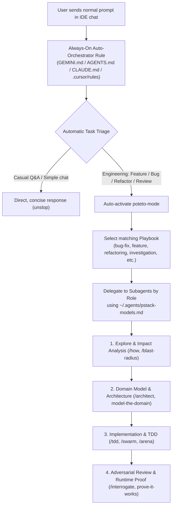

# Autonomous AI Coding Agent System + pstack

> 🌐 **Language / ภาษา:** [**English**](#english-documentation) | [**ภาษาไทย**](#เอกสารภาษาไทย) | [Standalone English (`README.en.md`)](./README.en.md)

---

<a id="english-documentation"></a>

## 🇬🇧 English Documentation

An **Auto-Orchestrator & Control Center** that turns **Antigravity**, **Cursor**, **Claude Code**, **Codex**, and **VS Code (GitHub Copilot)** into a full **Autonomous AI Coding Agent System** powered by **[pstack (`poteto-mode`)](https://github.com/backnotprop/pstack)**—automatically routing engineering tasks through rigorous playbooks and multi-agent workflows without requiring manual `/poteto-mode` slash commands on every prompt.

### ✨ Key Features

- **Zero-Slash-Command Auto-Routing:** Evaluates every prompt automatically. Software engineering tasks (features, bug fixes, refactors, architecture, code reviews) automatically activate `poteto-mode`, select the matching playbook, and spawn specialized subagents. Casual questions receive direct, concise answers (`unslop`).
- **Multi-IDE & Multi-Harness Support:** Syncs all 52 skills and always-on rules across **Antigravity**, **Cursor**, **Claude Code**, **Codex**, and **VS Code (GitHub Copilot)** in a single command.
- **Auto-Install Upstream `pstack`:** If `pstack` is not found on a machine, `install` automatically clones `backnotprop/pstack` into `./vendor/pstack` and generates default role-to-model settings.
- **Background Auto-Update Scheduler:** Automatically pulls upstream `pstack` updates in the background (daily and at logon via Windows Task Scheduler / Startup or macOS/Linux Cron), conflict-free and offline-safe.
- **Cross-Platform & Zero Hardcoded Paths:** Works out of the box on **Windows (`pstack-ctl.ps1`)** and **macOS / Linux (`pstack-ctl.sh`)**.
- **Built-in `deslop` Custom Skill:** Ships with a ready-to-use `deslop` skill to strip AI code slop, dead code, and redundant comments before committing.

### 🏗️ System Architecture



### 🚀 Quick Start

#### 1. Clone the repository
```bash
git clone https://github.com/souklaos8899-lgtm/Autonomous-AI-Coding-Agent-System-Pstack.git
cd Autonomous-AI-Coding-Agent-System-Pstack
```

#### 2. Run the 1-command installer

**Windows (PowerShell):**
```powershell
powershell -ExecutionPolicy Bypass -File .\pstack-ctl.ps1 install
```

**macOS / Linux / Git Bash:**
```bash
chmod +x ./pstack-ctl.sh
./pstack-ctl.sh install
```

### 🛠️ CLI Commands (`pstack-ctl`)

| Windows (PowerShell) | macOS / Linux | Description |
| :--- | :--- | :--- |
| `.\pstack-ctl.ps1 install` | `./pstack-ctl.sh install` | First-time setup: clones `pstack` if missing, links all 52 skills, enables auto-mode, and registers background auto-update. |
| `.\pstack-ctl.ps1 status` | `./pstack-ctl.sh status` | Check skill symlinks, IDE auto-rules, model budget, and auto-update scheduler status. |
| `.\pstack-ctl.ps1 update` | `./pstack-ctl.sh update` | Pull latest upstream `pstack` updates without Git conflicts, re-link skills, and re-apply auto-invocation. |
| `.\pstack-ctl.ps1 enable-autoupdate` | `./pstack-ctl.sh enable-autoupdate` | Enable silent background auto-updates (daily & at logon). |
| `.\pstack-ctl.ps1 disable-autoupdate` | `./pstack-ctl.sh disable-autoupdate` | Disable background auto-updates. |
| `.\pstack-ctl.ps1 enable-auto` | `./pstack-ctl.sh enable-auto` | Enable automatic `pstack` orchestration across all projects. |
| `.\pstack-ctl.ps1 disable-auto` | `./pstack-ctl.sh disable-auto` | Disable auto-mode (revert to manual `/poteto-mode` invocation). |
| `.\pstack-ctl.ps1 sync` | `./pstack-ctl.sh sync` | Sync changes after editing `rules/auto-orchestrator.md` or adding skills in `custom-skills/`. |
| `.\pstack-ctl.ps1 init-project <Path>` | `./pstack-ctl.sh init-project <Path>` | Copy `AGENTS.md`, `CLAUDE.md`, and `.github/copilot-instructions.md` into a specific project directory. |

### ⚙️ Customization

1. **Customize Auto-Routing Rules:** Edit [`rules/auto-orchestrator.md`](./rules/auto-orchestrator.md) and run `.\pstack-ctl.ps1 sync`.
2. **Configure Per-Role Models:** Edit `~/.agents/pstack-models.md` or run `/setup-pstack` in your IDE chat.
3. **Add Custom Skills:** Create `custom-skills/<skill-name>/SKILL.md` and run `.\pstack-ctl.ps1 sync`.

---

<a id="เอกสารภาษาไทย"></a>

## 🇹🇭 เอกสารภาษาไทย

ระบบเชื่อมต่อและสั่งการอัตโนมัติ (**Auto-Orchestrator & Control Center**) ที่เปลี่ยนให้ **Antigravity**, **Cursor**, **Claude Code**, **Codex**, และ **VS Code** ทำงานเป็น **Autonomous AI Coding Agent** โดยเรียกใช้เวิร์กโฟลว์วิศวกรรมของ **[pstack (`poteto-mode`)](https://github.com/backnotprop/pstack)** เองอัตโนมัติโดยไม่ต้องพิมพ์คำสั่ง `/poteto-mode` นำหน้าทุกครั้ง

### ✨ คุณสมบัติหลัก

- **Zero-Slash-Command Auto-Routing:** วิเคราะห์คำขอของผู้ใช้ทุกเทิร์น หากเป็นงานวิศวกรรมซอฟต์แวร์ (Feature, Bug Fix, Refactoring, Architecture, Review) ระบบจะเปิดใช้งาน `poteto-mode` เลือก Playbook และแตก Subagents ให้อัตโนมัติ ส่วนคำถามพูดคุยทั่วไปจะตอบตรงประเด็น (`unslop`)
- **Multi-IDE & Multi-Harness Support:** ซิงค์สกิลทั้ง 52 ตัวและกฎอัตโนมัติเข้าสู่ **Antigravity**, **Cursor**, **Claude Code**, **Codex**, และ **VS Code (GitHub Copilot)** พร้อมกันในคำสั่งเดียว
- **Auto-Install Upstream `pstack`:** หากเครื่องที่โคลนโปรเจกต์นี้ไปแล้วยังไม่มี `pstack` สคริปต์จะดึง `backnotprop/pstack` จาก GitHub มาติดตั้งไว้ที่ `./vendor/pstack` และสร้างไฟล์ตั้งค่าโมเดลเริ่มต้นให้อัตโนมัติ
- **Background Auto-Update Scheduler:** มีระบบอัปเดต `pstack` เบื้องหลังอัตโนมัติทุกวันและเมื่อเปิดเครื่อง (รองรับทั้ง Windows Task Scheduler / Startup และ macOS/Linux Cron) แบบไม่ติด Git Conflict และปลอดภัยแม้ขณะออฟไลน์
- **Cross-Platform & Zero Hardcoded Paths:** ใช้งานได้กับทุกเครื่องและทุกระบบปฏิบัติการ ทั้งบน **Windows (`pstack-ctl.ps1`)** และ **macOS / Linux (`pstack-ctl.sh`)**
- **Built-in `deslop` Custom Skill:** มาพร้อมสกิลทำความสะอาดโค้ดขยะ (`deslop`) ก่อนส่งมอบงานในตัว

### 🚀 วิธีติดตั้งใช้งาน (Quick Start)

#### 1. โคลนโปรเจกต์ลงเครื่อง
```bash
git clone https://github.com/souklaos8899-lgtm/Autonomous-AI-Coding-Agent-System-Pstack.git
cd Autonomous-AI-Coding-Agent-System-Pstack
```

#### 2. รันคำสั่งติดตั้งและเปิดใช้งานอัตโนมัติ (1 คำสั่งจบ)

**สำหรับ Windows (PowerShell):**
```powershell
powershell -ExecutionPolicy Bypass -File .\pstack-ctl.ps1 install
```

**สำหรับ macOS / Linux / Git Bash:**
```bash
chmod +x ./pstack-ctl.sh
./pstack-ctl.sh install
```

### 🛠️ คำสั่งจัดการระบบ (`pstack-ctl`)

| คำสั่ง (Windows PowerShell) | คำสั่ง (macOS / Linux) | หน้าที่การทำงาน |
| :--- | :--- | :--- |
| `.\pstack-ctl.ps1 install` | `./pstack-ctl.sh install` | ติดตั้งครั้งแรก (ดึง `pstack`, เชื่อมลิงก์สกิล, เปิดโหมดอัตโนมัติ และเปิด Auto-Update) |
| `.\pstack-ctl.ps1 status` | `./pstack-ctl.sh status` | ตรวจสอบสถานะลิงก์สกิล กฎอัตโนมัติ การตั้งค่าโมเดล และสถานะ Auto-Update ในทุก IDE |
| `.\pstack-ctl.ps1 update` | `./pstack-ctl.sh update` | ดึงอัปเดตล่าสุดของ `pstack` จาก GitHub (ไม่ติด Git Conflict) พร้อมซิงค์และปลดล็อกสกิลใหม่ทันที |
| `.\pstack-ctl.ps1 enable-autoupdate` | `./pstack-ctl.sh enable-autoupdate` | เปิดระบบอัปเดต `pstack` เบื้องหลังอัตโนมัติทุกวันและเมื่อเปิดเครื่อง |
| `.\pstack-ctl.ps1 disable-autoupdate` | `./pstack-ctl.sh disable-autoupdate` | ปิดระบบอัปเดตเบื้องหลังอัตโนมัติ |
| `.\pstack-ctl.ps1 enable-auto` | `./pstack-ctl.sh enable-auto` | เปิดให้ AI เรียกใช้ `pstack` เองอัตโนมัติทุกโปรเจกต์ |
| `.\pstack-ctl.ps1 disable-auto` | `./pstack-ctl.sh disable-auto` | ปิดโหมดอัตโนมัติ (กลับไปพิมพ์ `/poteto-mode` ด้วยตัวเองแบบดั้งเดิม) |
| `.\pstack-ctl.ps1 sync` | `./pstack-ctl.sh sync` | ซิงค์กฎใหม่หลังจากที่คุณแก้ไขไฟล์ `rules/auto-orchestrator.md` หรือเพิ่มสกิลใน `custom-skills/` |
| `.\pstack-ctl.ps1 init-project <Path>` | `./pstack-ctl.sh init-project <Path>` | คัดลอกไฟล์ `AGENTS.md`, `CLAUDE.md`, และ `.github/copilot-instructions.md` ไปใส่ในโฟลเดอร์โปรเจกต์ที่ต้องการ |

### 💡 ตัวอย่างการทำงานจริงเมื่อติดตั้งเสร็จ

1. **สั่งสร้างฟีเจอร์ใหม่:**
   > *"ช่วยเพิ่มระบบตั้งค่ารหัสผ่านหมดอายุทุก 90 วัน พร้อมแจ้งเตือนก่อนหมดอายุ 7 วัน"*
   - ระบบเปิด Playbook `feature.md` -> สำรวจผลกระทบด้วย `/how` และ `/blast-radius` -> กำหนด Data Shape ตาม `principle-model-the-domain` -> เขียนโค้ดและเทสต์ด้วย `/tdd` -> รันพิสูจน์ผลลัพธ์จริงตาม `principle-prove-it-works`
2. **สั่งแก้บั๊กที่ซับซ้อน:**
   > *"หน้า Dashboard เวลากดสลับเมนูเร็วๆ แล้วข้อมูลชอบค้างเป็นของหน้าเก่า ช่วยเช็กและแก้ให้หน่อย"*
   - ระบบเปิด Playbook `bug-fix.md` -> สืบหาต้นตอด้วย `/figure-it-out` และ `/why` ตามหลัก `principle-fix-root-causes` -> แก้ปัญหาที่ต้นเหตุและรันทดสอบยืนยัน
3. **สั่งตรวจสอบความปลอดภัยและเขียนเทสต์ขนานกัน:**
   > *"ช่วยตรวจช่องโหว่ของระบบโอนเงิน และเขียน Unit Test ให้ครบทุกไฟล์ก่อนขึ้น Production"*
   - ระบบปล่อย Subagents รุมตรวจหาช่องโหว่ด้วย `/interrogate` -> กระจาย `swarm workers` เขียนเทสต์ขนานกันด้วย `/swarm` -> ล้างคอมเมนต์และโค้ดขยะด้วย `/no-comments` และ `/deslop`

### ⚙️ การปรับแต่งในอนาคต

1. **ปรับเปลี่ยนกติกาการเลือกสกิลอัตโนมัติ:** แก้ไขไฟล์ [`rules/auto-orchestrator.md`](./rules/auto-orchestrator.md) แล้วรัน `.\pstack-ctl.ps1 sync`
2. **ปรับแต่งโมเดลของแต่ละบทบาท (Subagent Models):** แก้ไขไฟล์ `~/.agents/pstack-models.md` หรือพิมพ์ `/setup-pstack` ในแชทของ IDE
3. **เพิ่มสกิลส่วนตัว (Custom Skills):** สร้างโฟลเดอร์สกิลใหม่ใน [`custom-skills/<skill-name>/SKILL.md`](./custom-skills/README.md) แล้วรัน `.\pstack-ctl.ps1 sync`

---

## 📄 License
MIT
