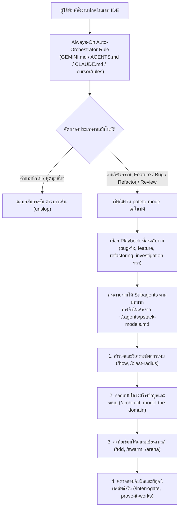

# Autonomous AI Coding Agent System + pstack

ระบบเชื่อมต่อและสั่งการอัตโนมัติ (**Auto-Orchestrator & Control Center**) ที่เปลี่ยนให้ **Antigravity**, **Cursor**, **Claude Code**, **Codex**, และ **VS Code** ทำงานเป็น **Autonomous AI Coding Agent** โดยเรียกใช้เวิร์กโฟลว์วิศวกรรมของ **[pstack (`poteto-mode`)](https://github.com/backnotprop/pstack)** เองอัตโนมัติโดยไม่ต้องพิมพ์คำสั่ง `/poteto-mode` นำหน้าทุกครั้ง

---

## ✨ คุณสมบัติหลัก (Key Features)

- **Zero-Slash-Command Auto-Routing:** วิเคราะห์คำขอของผู้ใช้ทุกเทิร์น หากเป็นงานวิศวกรรมซอฟต์แวร์ (Feature, Bug Fix, Refactoring, Architecture, Review) ระบบจะเปิดใช้งาน `poteto-mode` เลือก Playbook และแตก Subagents ให้อัตโนมัติ ส่วนคำถามพูดคุยทั่วไปจะตอบตรงประเด็น (`unslop`)
- **Multi-IDE & Multi-Harness Support:** ซิงค์สกิลทั้ง 52 ตัวและกฎอัตโนมัติเข้าสู่ **Antigravity**, **Cursor**, **Claude Code**, **Codex**, และ **VS Code (GitHub Copilot)** พร้อมกันในคำสั่งเดียว
- **Auto-Install Upstream `pstack`:** หากเครื่องที่โคลนโปรเจกต์นี้ไปแล้วยังไม่มี `pstack` สคริปต์จะดึง `backnotprop/pstack` จาก GitHub มาติดตั้งไว้ที่ `./vendor/pstack` และสร้างไฟล์ตั้งค่าโมเดลเริ่มต้นให้อัตโนมัติ
- **Background Auto-Update Scheduler:** มีระบบอัปเดต `pstack` เบื้องหลังอัตโนมัติทุกวันและเมื่อเปิดเครื่อง (รองรับทั้ง Windows Task Scheduler / Startup และ macOS/Linux Cron) แบบไม่ติด Git Conflict และปลอดภัยแม้ขณะออฟไลน์
- **Cross-Platform & Zero Hardcoded Paths:** ใช้งานได้กับทุกเครื่องและทุกระบบปฏิบัติการ ทั้งบน **Windows (`pstack-ctl.ps1`)** และ **macOS / Linux (`pstack-ctl.sh`)**
- **Built-in `deslop` Custom Skill:** มาพร้อมสกิลทำความสะอาดโค้ดขยะ (`deslop`) ก่อนส่งมอบงานในตัว

---

## 🏗️ สถาปัตยกรรมการทำงาน (How It Works)



---

## 🚀 วิธีติดตั้งใช้งาน (Quick Start)

### 1. โคลนโปรเจกต์ลงเครื่อง
```bash
git clone https://github.com/souklaos8899-lgtm/Autonomous-AI-Coding-Agent-System-Pstack.git
cd Autonomous-AI-Coding-Agent-System-Pstack
```

### 2. รันคำสั่งติดตั้งและเปิดใช้งานอัตโนมัติ (1 คำสั่งจบ)

**สำหรับ Windows (PowerShell):**
```powershell
powershell -ExecutionPolicy Bypass -File .\pstack-ctl.ps1 install
```

**สำหรับ macOS / Linux / Git Bash:**
```bash
chmod +x ./pstack-ctl.sh
./pstack-ctl.sh install
```

> **สิ่งที่คำสั่ง `install` ทำให้โดยอัตโนมัติ:**
> 1. ตรวจหา `pstack` ในเครื่อง (หากไม่มีจะ `git clone` มาไว้ที่ `./vendor/pstack` อัตโนมัติ)
> 2. สร้างลิงก์สกิลทั้ง 52 ตัวเข้าสู่โฟลเดอร์ Global ของ Antigravity, Cursor, Claude Code, และ Codex
> 3. ปลดล็อก `disable-model-invocation` เพื่อให้ AI เรียกใช้สกิลของ `pstack` เองได้โดยไม่ต้องพิมพ์ `/...`
> 4. ติดตั้งกฎควบคุมอัตโนมัติ (`AGENTS.md`, `GEMINI.md`, `CLAUDE.md`, `.mdc`) และเปิดระบบ Auto-Update เบื้องหลัง

---

## 🛠️ คำสั่งจัดการระบบ (`pstack-ctl`)

| คำสั่ง (Windows PowerShell) | คำสั่ง (macOS / Linux) | หน้าที่การทำงาน |
| :--- | :--- | :--- |
| `.\pstack-ctl.ps1 install` | `./pstack-ctl.sh install` | ติดตั้งครั้งแรก (ดึง `pstack`, เชื่อมลิงก์สกิล, เปิดโหมดอัตโนมัติ และเปิด Auto-Update) |
| `.\pstack-ctl.ps1 status` | `./pstack-ctl.sh status` | ตรวจสอบสถานะลิงก์สกิล กฎอัตโนมัติ การตั้งค่าโมเดล และสถานะ Auto-Update ในทุก IDE |
| `.\pstack-ctl.ps1 update` | `./pstack-ctl.sh update` | ดึงอัปเดตล่าสุดของ `pstack` จาก GitHub (ไม่ติด Git Conflict) พร้อมซิงค์และปลดล็อกสกิลใหม่ทันที |
| `.\pstack-ctl.ps1 enable-autoupdate` | `./pstack-ctl.sh enable-autoupdate` | เปิดระบบอัปเดต `pstack` เบื้องหลังอัตโนมัติทุกวันและเมื่อเปิดเครื่อง |
| `.\pstack-ctl.ps1 disable-autoupdate` | `./pstack-ctl.sh disable-autoupdate` | ปิดระบบอัปเดตเบื้องหลังอัตโนมัติ |
| `.\pstack-ctl.ps1 enable-auto` | `./pstack-ctl.sh enable-auto` | เปิดให้ AI เรียกใช้ `pstack` เองอัตโนมัติทุกโปรเจกต์ |
| `.\pstack-ctl.ps1 disable-auto` | `./pstack-ctl.sh disable-auto` | ปิดโหมดอัตโนมัติ (กลับไปพิมพ์ `/poteto-mode` ด้วยตัวเองแบบดั้งเดิม) |
| `.\pstack-ctl.ps1 sync` | `./pstack-ctl.sh sync` | ซิงค์กฎใหม่หลังจากที่คุณแก้ไขไฟล์ `rules/auto-orchestrator.md` หรือเพิ่มสกิลใน `custom-skills/` |
| `.\pstack-ctl.ps1 init-project <Path>` | `./pstack-ctl.sh init-project <Path>` | คัดลอกไฟล์ `AGENTS.md`, `CLAUDE.md`, และ `.github/copilot-instructions.md` ไปใส่ในโฟลเดอร์โปรเจกต์ที่ต้องการ |

---

## 💡 ตัวอย่างการทำงานจริงเมื่อติดตั้งเสร็จ (Example Workflows)

คุณสามารถพิมพ์สั่งงานด้วยภาษาคนตามปกติในแชทของ IDE โดยระบบจะเลือกใช้เครื่องมือของ `pstack` เองเบื้องหลัง:

1. **สั่งสร้างฟีเจอร์ใหม่:**
   > *"ช่วยเพิ่มระบบตั้งค่ารหัสผ่านหมดอายุทุก 90 วัน พร้อมแจ้งเตือนก่อนหมดอายุ 7 วัน"*
   - ระบบเปิด Playbook `feature.md` -> สำรวจผลกระทบด้วย `/how` และ `/blast-radius` -> กำหนด Data Shape ตาม `principle-model-the-domain` -> เขียนโค้ดและเทสต์ด้วย `/tdd` -> รันพิสูจน์ผลลัพธ์จริงตาม `principle-prove-it-works`
2. **สั่งแก้บั๊กที่ซับซ้อน:**
   > *"หน้า Dashboard เวลากดสลับเมนูเร็วๆ แล้วข้อมูลชอบค้างเป็นของหน้าเก่า ช่วยเช็กและแก้ให้หน่อย"*
   - ระบบเปิด Playbook `bug-fix.md` -> สืบหาต้นตอด้วย `/figure-it-out` และ `/why` ตามหลัก `principle-fix-root-causes` -> แก้ปัญหาที่ต้นเหตุและรันทดสอบยืนยัน
3. **สั่งตรวจสอบความปลอดภัยและเขียนเทสต์ขนานกัน:**
   > *"ช่วยตรวจช่องโหว่ของระบบโอนเงิน และเขียน Unit Test ให้ครบทุกไฟล์ก่อนขึ้น Production"*
   - ระบบปล่อย Subagents รุมตรวจหาช่องโหว่ด้วย `/interrogate` -> กระจาย `swarm workers` เขียนเทสต์ขนานกันด้วย `/swarm` -> ล้างคอมเมนต์และโค้ดขยะด้วย `/no-comments` และ `/deslop`

---

## ⚙️ การปรับแต่งในอนาคต (Customization Guide)

1. **ปรับเปลี่ยนกติกาการเลือกสกิลอัตโนมัติ:**
   แก้ไขไฟล์แม่แบบที่ [`rules/auto-orchestrator.md`](./rules/auto-orchestrator.md) แล้วรัน `.\pstack-ctl.ps1 sync` เพื่ออัปเดตไปยังทุก IDE พร้อมกัน
2. **ปรับแต่งโมเดลของแต่ละบทบาท (Subagent Models):**
   แก้ไขไฟล์ `~/.agents/pstack-models.md` หรือพิมพ์ `/setup-pstack` ในแชทของ IDE
3. **เพิ่มสกิลส่วนตัว (Custom Skills):**
   สร้างโฟลเดอร์สกิลใหม่ใน [`custom-skills/<skill-name>/SKILL.md`](./custom-skills/README.md) แล้วรัน `.\pstack-ctl.ps1 sync`

---

## 📁 โครงสร้างโปรเจกต์ (Repository Structure)

```text
Autonomous-AI-Coding-Agent-System-Pstack/
├── custom-skills/
│   ├── deslop/
│   │   └── SKILL.md           # สกิลทำความสะอาดโค้ดขยะก่อน Commit
│   └── README.md              # คู่มือการเพิ่มสกิลส่วนตัว
├── rules/
│   └── auto-orchestrator.md   # ไฟล์แม่แบบกฎอัตโนมัติ (Master Rule Template)
├── pstack-ctl.ps1             # สคริปต์ควบคุมสำหรับ Windows PowerShell
├── pstack-ctl.sh              # สคริปต์ควบคุมสำหรับ macOS / Linux / Git Bash
├── .gitignore
└── README.md
```

---

## 📄 License
MIT
