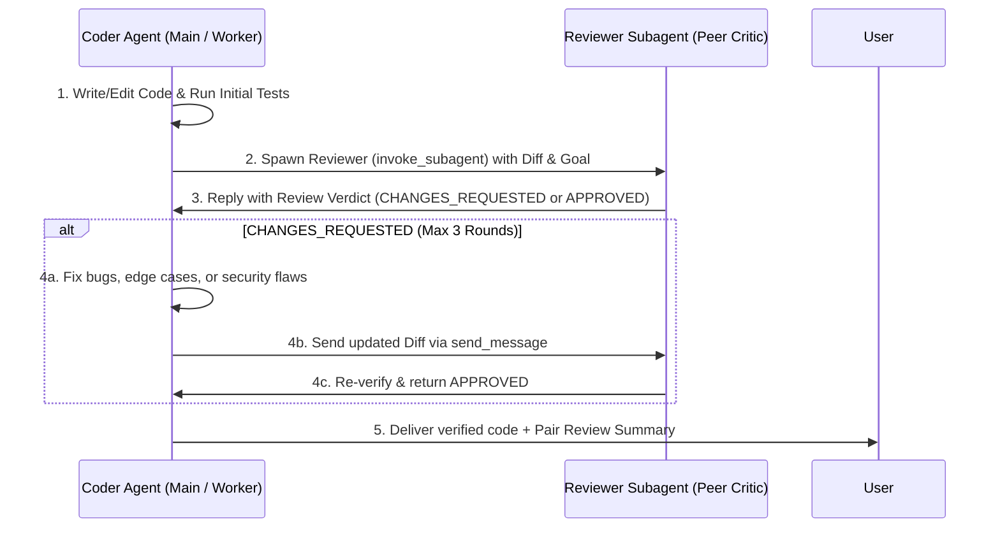

# Mandatory Pair Programming Loop (`Coder ↔ Reviewer`)

Every task that creates or modifies code **must** go through a 2-Agent Pair Programming & Review dialogue before reporting completion to the user.

---

## Workflow (`Coder ↔ Reviewer` Dialogue)

### Step 1: Implementation & Local Check (Coder)
- Implement the feature, bug fix, or refactoring according to the matched `pstack` playbook.
- Run local build/typecheck/tests first so obvious syntax errors are resolved before peer review.

### Step 2: Spawn the Reviewer Subagent
Spawn a dedicated **Reviewer Subagent** (`invoke_subagent` with `TypeName: "research"` or `"self"`, `Model: "pro"` for complex/security changes or `"flash"` for routine edits) with this prompt structure:
- **Context:** The user's original goal and the list of modified files (or `git diff`).
- **Reviewer Checklist:**
  1. **Logic & Edge Cases (`interrogate`):** Race conditions, null/empty states, off-by-one errors, unhandled promises/errors.
  2. **Security (`security-audit`):** Missing auth/RBAC checks, IDOR, injection vectors, unsafe inputs.
  3. **Architecture & Types (`project-structure`, `typescript-best-practices`):** Layer violations, `any` types, broken imports.
  4. **Cleanliness (`deslop`, `no-comments`):** Dead code, redundant wrappers, slop comments.
- **Required Output:** A strict verdict (`APPROVED` or `CHANGES_REQUESTED`) with exact file:line citations for any required fixes.

### Step 3: Back-and-Forth Resolution Loop (Max 3 Rounds)
- If the Reviewer returns `CHANGES_REQUESTED`:
  1. The Coder applies the fixes and re-runs tests.
  2. In Antigravity, use `send_message` (targeting the Reviewer's `conversationId`) to show the updated diff and ask for final sign-off (up to 3 rounds max to prevent infinite loops).
- Once `APPROVED` is received, proceed to final delivery.

### Step 4: Report the Dialogue to the User
In your final response to the user, include a brief section:
- **`🤝 Pair Review (`Coder ↔ Reviewer`):** Summarize what the Reviewer Subagent checked, any issues it caught and forced the Coder to fix, and the final `APPROVED` status.

